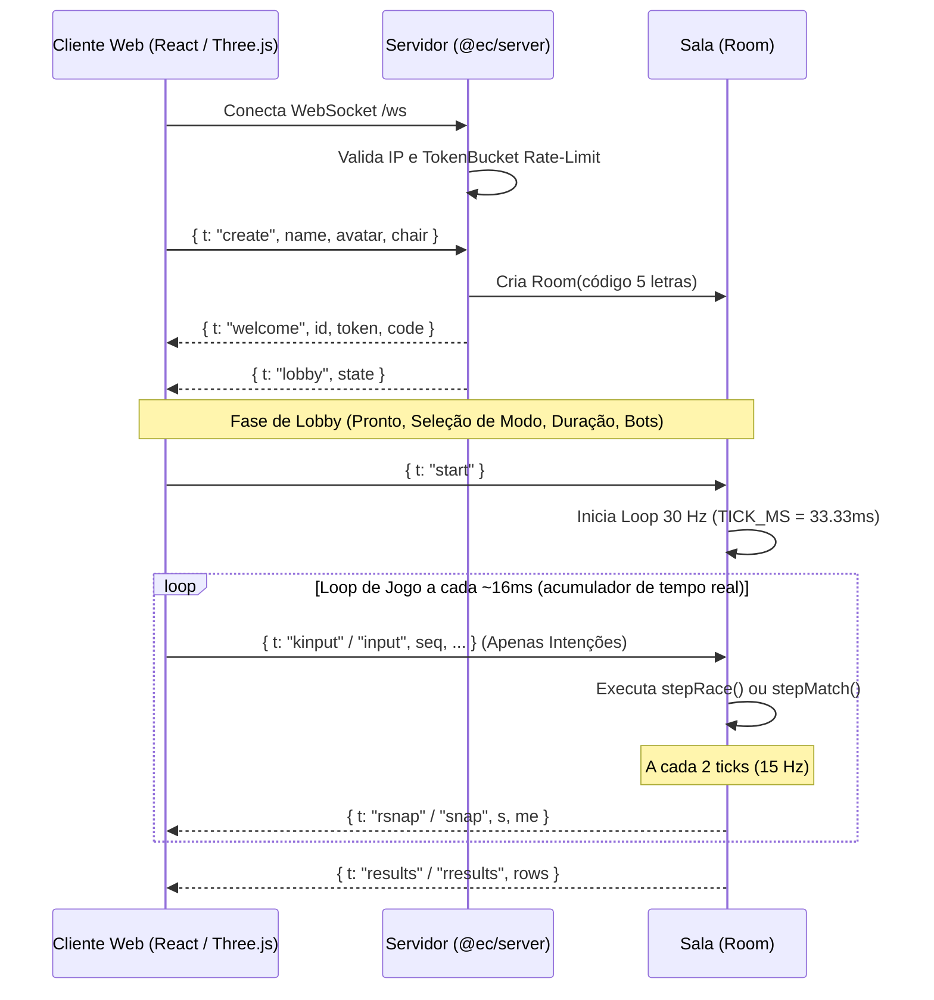

# Documentação e Mapeamento Completo da Aplicação: Expediente Caótico

> **Data de Análise:** Outubro de 2026  
> **Repositório:** `expediente-caotico`  
> **Objetivo:** Mapeamento arquitetural, funcional, de regras de negócio, protocolo de rede e código-fonte da aplicação.

---

## 1. Visão Geral e Filosofia do Projeto

**Expediente Caótico** é um jogo multiplayer 3D para navegadores ambientado em um escritório corporativo satírico. O jogo foi desenhado especificamente para equipes de trabalho jogarem durante pausas e intervalos, com as seguintes diretrizes centrais:

1. **Zero Instalação:** Execução 100% no navegador via WebGL (Three.js) e WebSockets.
2. **Reconhecimento Imediato:** Cada colaborador cria um avatar ("Crachá") e uma cadeira de escritório personalizada que refletem sua aparência real.
3. **Servidor 100% Autoritativo:** O cliente envia somente intenções do jogador (movimentação, mira, clique de disparo, comandos de aceleração/direção). Dano, vida, recargas, pontuação, checkpoints e física oficial são calculados exclusivamente no servidor.
4. **Dois Modos de Jogo em uma mesma Sala:**
   - **Tiroteio Corporativo (Shooter TPS):** Combate em terceira pessoa com arremesso de bolinhas de papel, 12 habilidades de escritório evolutivas e zona de controle móvel ("Reunião Relâmpago").
   - **Rally da Firma (Modo Corrida):** Corrida estilo kart com cadeiras de escritório ao longo de 3 voltas no "Circuito Corporativo", com derrapagens com turbo e 8 power-ups temáticos.
5. **Rede Resiliente e Baixa Latência:** Simulação em 30 Hz no servidor, snapshots a 15 Hz, interpolação de entidades remotas e previsão no cliente (*client-side prediction*) com reconciliação baseada em números de sequência.

---

## 2. Estrutura do Monorepo e Arquitetura de Pacotes

O projeto é configurado como um monorepo gerenciado pelo **PNPM (v10)**, exigindo **Node.js >= 22**:

```
Jogo/
├── packages/
│   └── shared/          # Motor de simulação pura, regras, protocolos, tipos e balanceamento
├── apps/
│   ├── server/          # Servidor Node.js + WebSocket + servidor de arquivos estáticos
│   └── web/             # Cliente SPA React 19 + Three.js + Vite
├── docs/                # PRDs, especificações funcionais e planos de implementação
├── Dockerfile           # Build de produção multi-stage
├── package.json         # Scripts de workspace raiz
├── pnpm-workspace.yaml  # Definição dos workspaces (@ec/shared, @ec/server, @ec/web)
└── vitest.config.ts     # Configuração central de testes unitários e de integração
```

### 2.1 Visão Geral dos Pacotes

| Pacote | Nome | Responsabilidade | Tecnologias Chave |
|---|---|---|---|
| `packages/shared` | `@ec/shared` | Modelos de dados, regras de colisão, física da cadeira, habilidades, progressão, pistas, mapa, validação Zod e RNG Mulberry32 determinístico. Sem dependências de DOM ou Node.js. | TypeScript, Zod |
| `apps/server` | `@ec/server` | Servidor HTTP e WebSocket (`ws`), gerenciador de salas (`RoomManager`), loop de física a 30 ticks/s, rate-limiting, proteção DoS e reconexão de jogadores. | Node.js, `ws`, `zod`, `esbuild`, `tsx` |
| `apps/web` | `@ec/web` | Aplicação web frontend: renderização 3D com Three.js, áudio, HUD, minimapa 2D, telas de criação de avatar/cadeira, lobby e telas de resultados. | React 19, Three.js, Vite, CSS moderno |

---

## 3. Módulo `@ec/shared`: O Motor de Simulação Pura

O pacote `packages/shared` é a espinha dorsal de todo o jogo. Ele é agnóstico de ambiente (funciona identicamente no Node.js do servidor e no browser do cliente).

```mermaid
graph TD
    A["@ec/shared"] --> B["data/ (Configurações e Balanceamento)"]
    A --> C["sim/ (Simulação do Modo Tiroteio)"]
    A --> D["race/ (Simulação do Modo Corrida)"]
    A --> E["protocol.ts (Validação Zod de Rede)"]
    A --> F["rng.ts (Mulberry32 Determinístico)"]
    
    B --> B1["balance.ts"]
    B --> B2["map.ts"]
    B --> B3["abilities.ts"]
    B --> B4["synergies.ts"]
    B --> B5["avatar.ts"]
    
    C --> C1["collision.ts (Slab Raycast & AABB)"]
    C --> C2["combat.ts (Dano, Status, Escudos)"]
    C --> C3["progression.ts (XP, Árvore de Nível)"]
    C --> C4["objective.ts (Reunião Relâmpago)"]
    C --> C5["bots.ts (IA Estagiários)"]
    C --> C6["match.ts (Loop da Partida)"]
    
    D --> D1["track.ts (Spline & Checkpoints)"]
    D --> D2["chair.ts (Personalização da Cadeira)"]
    D --> D3["kart.ts (Física Determinística)"]
    D --> D4["items.ts (Caixas e Efeitos)"]
    D --> D5["laps.ts (Contagem de Voltas)"]
    D --> D6["bots.ts (Piloto Automático)"]
    D --> D7["match.ts (Loop da Corrida)"]
```



### 3.1 Balanceamento Global do Tiroteio (`packages/shared/src/data/balance.ts`)
- **Frequência de Tick:** 30 Hz (`TICK_MS = 33.33ms`).
- **Frequência de Snapshot:** 1 a cada 2 ticks = 15 Hz.
- **Vida Máxima:** 100 HP.
- **Bolinha de Papel:** 9 de dano, cadência de 350 ms entre disparos, velocidade de 34 m/s, alcance de 30 m, raio de 0.22 m.
- **Esquiva (Espaço):** Distância de 4.5 m, duração de 250 ms (com invulnerabilidade), recarga de 3.0 s.
- **Respawn:** 3.0 s de espera com 1.5 s de invulnerabilidade ao reaparecer. Imunidade temporária a atordoamento por 2.0 s.
- **Objetivo Reunião Relâmpago:** Raio de 4 m, ciclo de 45 s trocando de sala. 10 pontos a cada 5 s acumulados sozinho dentro da área; 50 pontos bônus para quem liderar o tempo de posse ao fim do ciclo.
- **Pontuação:** Eliminação: +100 pts (+60 XP); Assistência: +40 pts (+25 XP) com critério de mínimo 20 de dano causado nos últimos 8 segundos.

### 3.2 O Mapa do Escritório (`packages/shared/src/data/map.ts` e `sim/collision.ts`)
- O escritório é modelado como uma lista de caixas AABB (`Box`: `x`, `z`, largura `w`, profundidade `d`, altura `h`, tipo estético `kind`).
- **Sistema de Cobertura Baixa vs Alta:**
  - Caixas com altura `h < 1.2m` (mesas, sofás, balcões baixos) bloqueiam a passagem de personagens (`moveCircle`), mas **permitem a passagem de tiros de bolinhas de papel** (`segmentBoxT`).
  - Caixas com `h >= 1.2m` (paredes, divisórias altas, armários) bloqueiam movimentação e projéteis.
- **Detecção de Colisão Contínua:** `moveCircle` divide o deslocamento em sub-passos menores que o raio do jogador (`r * 0.8`), impedindo que personagens atravessem paredes mesmo com alta velocidade ou *knockback*.

### 3.3 As 12 Habilidades e Especializações (`packages/shared/src/data/abilities.ts`)
As habilidades dividem-se em 4 famílias corporativas:

| ID | Nome | Família | Tipo Mecânico | Efeito Base | Especialização A | Especialização B |
|---|---|---|---|---|---|---|
| **A1** | Choque do TI | Ofensiva | Chain (Raio em cadeia) | 18 dano, salta até 2 alvos | **Sobrecarga:** +2 saltos | **Curto-circuito:** Atordoa 1º alvo por 0,6 s |
| **A2** | Cadeira Giratória | Ofensiva | Nova (Ao redor) | 20 dano, raio 3.5 m, empurrão | **Tornado:** Raio +40% | **Rodinha Solta:** Empurrão 2x e lentidão 35% |
| **A3** | Impressora Descontrolada | Ofensiva | Fan (Leque) | 5 folhas, 7 dano cada | **Modo Rascunho:** +3 folhas | **Toner:** Folhas causam lentidão |
| **B1** | Café na Cara | Controle | Cone | 10 dano, cone de 70°, cega 2,0 s | **Expresso:** Cegueira +1,5 s | **Cappuccino:** +6 dano e lentidão |
| **B2** | Grampeador Nervoso | Controle | Projétil Rápido | 14 dano, atordoa 0,8 s | **Grampo Duplo:** Dispara 2 grampos | **Grampo Industrial:** Atordoa +0,6 s |
| **B3** | Arquivo Confidencial | Controle | Projétil Pesado | 16 dano, empurrão forte (14) | **Pasta Suspensa:** Atravessa inimigos | **Arquivo Morto:** Maior raio e +8 dano |
| **C1** | Sprint do Estagiário | Mobilidade | Dash (Avanço) | Arrancada de 9 m em 220 ms | **Atropelo:** 15 dano e empurrão ao tocar | **Hora Extra:** Recarga -40% |
| **C2** | Escudo do Jurídico | Defesa | Buff | Escudo de 30 de vida por 4 s | **Liminar:** Escudo +15 | **Recurso:** Cura 20 de vida |
| **C3** | Café Duplo | Mobilidade | Buff | +50% velocidade e cadência por 4 s | **Café Triplo:** +2 s de duração | **Com Açúcar:** Cura 15 de vida |
| **D1** | Vazamento de TI | Ofensiva | Zona no Chão | Poça de dados, 6 dano a cada 500 ms | **Vazamento Geral:** Raio +40% | **Dados Corrompidos:** Causa lentidão |
| **D2** | Reunião Obrigatória | Controle | Zona no Chão | Área com 50% de lentidão contínua | **Pauta Extensa:** +2 s de duração | **Convocação:** Atordoa 0,5 s ao lançar |
| **D3** | Teletransporte do Home Office | Mobilidade | Teleporte | Teleporta para onde mirou (até 12 m) | **VPN:** Recarga -40% | **Volta Presencial:** Escudo de 20 ao chegar |

### 3.4 Sinergias Ativas (`packages/shared/src/data/synergies.ts`)
Quando um jogador equipa simultaneamente um determinado par de habilidades, desbloqueia automaticamente uma sinergia:
1. **Rede Instável (`A1` + `D1`):** Alvos atingidos pelo Choque do TI sofrem lentidão de 30% por 1 segundo.
2. **Café no Papel (`B1` + `A3`):** As folhas da Impressora Descontrolada causam cegueira de 0,5 s.
3. **Mobília Voadora (`B3` + `A2`):** O empurrão da Cadeira Giratória aumenta em +50%.
4. **Plantão Jurídico (`C2` + `D2`):** Lançar a Reunião Obrigatória concede imediatamente um escudo de 15.

### 3.5 Sistema de Evolução em Partida (`packages/shared/src/sim/progression.ts`)
- Cada nível ganho apresenta 3 opções válidas geradas pelo servidor (novas habilidades até o teto de 3, aumento de nível até V, especialização A ou B ao alcançar o nível III, ou melhorias de atributos: +15 Vida, +8% Velocidade, +12% Dano de Bolinha).
- O jogador tem **8 segundos** para escolher. Caso o tempo expire, o servidor aplica automaticamente a primeira opção para não interromper a partida.

---

## 4. O Modo Rally da Firma (Corrida de Cadeiras)

O modo de corrida (`packages/shared/src/race/`) transforma o jogo em um clássico jogo de kart sobre rodas de cadeira giratória:

### 4.1 Física Determinística da Cadeira (`packages/shared/src/race/kart.ts`)
- **Velocidade Máxima:** 16 m/s (~58 km/h).
- **Aceleração:** 8 m/s² (atinge a máxima em ~2 segundos).
- **Freio e Marcha Ré:** Freio forte (14 m/s²); marcha ré limitada a 5 m/s.
- **Giro Parado:** Quando a cadeira está com velocidade próxima de zero, ela gira no próprio eixo (`spinInPlace = 1.3 rad/s`), permitindo manobras fáceis.
- **Mecânica de Derrapagem (Drift):**
  - Ao segurar `Espaço` durante uma curva em velocidade acima de 8 m/s, a cadeira entra em *drift*.
  - Segurar por **0,8 s** acumula o **Turbo Nível 1** (0,6 s de boost a 22 m/s).
  - Segurar por **1,6 s** acumula o **Turbo Nível 2** (1,0 s de boost a 22 m/s).
- **Colisão com Paredes:** Reduz a velocidade em 50% e desliza na tangente da parede.
- **Carpete Lento:** Trechos com carpete na parte interna de curvas fechadas limitam a velocidade máxima a 60% (desencorajando cortar curvas pela grama/carpete).

### 4.2 Traçado e Checkpoints (`packages/shared/src/race/track.ts` e `laps.ts`)
- **Pista do Circuito Corporativo:** Linha central contínua de ~350 metros definida por 25 pontos de controle com larguras variáveis de 9 a 12 metros.
- Passa em sequência por: **Recepção (Largada)** $\rightarrow$ **Corredor Longo** $\rightarrow$ **Ilhas de Mesas (Chicane)** $\rightarrow$ **Copa** $\rightarrow$ **Sala de Reunião** $\rightarrow$ **TI (Zigue-Zague)** $\rightarrow$ **Recepção**.
- **Checkpoints Anti-Trapaça:** A cada 20 metros existe um checkpoint. O servidor valida a passagem estritamente ordenada. Cortar caminho ou andar na contramão não pontua e dispara aviso de contramão.
- **Cálculo de Progresso Contínuo:** A posição na corrida é determinada por:  
  $$\text{Progresso Total} = \text{Voltas Completadas} + \frac{\text{Distância ao Longo da Linha Central}}{\text{Comprimento Total da Pista}}$$
  Isso elimina qualquer possibilidade de empate em posições.

### 4.3 Os 8 Itens Corporativos e Distribuição por Pelotão (`packages/shared/src/race/items.ts`)

| Item | Efeito | Foco no Pelotão |
|---|---|---|
| **Café Expresso** | Turbo de velocidade por 1,2 s | 2ª Metade (trás) |
| **Café Expresso Triplo** | 3 cargas de turbo de 1,2 s | 2ª Metade (trás) |
| **Grampeador** | Dispara projétil linear que faz o rival atingido rodopiar por 1,0 s | 1ª Metade (frente) |
| **Poça de Café** | Armadilha de poça no chão; quem passar derrapa por 0,8 s | 1ª Metade (frente) |
| **Resma de Papel** | Obstáculo sólido descartado para trás que corta 70% da velocidade | 1ª Metade (frente) |
| **Aviãozinho de Papel** | Projétil teleguiado que persegue a cadeira imediatamente à frente (nunca o líder) | 2ª Metade (trás) |
| **Pasta do Jurídico** | Escudo defensivo de 8 s que anula o próximo ataque recebido | 1ª Metade (frente) |
| **Post-it na Tela** | Cola um post-it que obstrui a visão do rival à frente por 2,0 s | 2ª Metade (trás) |

> **Filosofia de Rubberbanding:** O jogo não possui itens punitivos contra o primeiro colocado (sem "casco azul"). Quem pilota melhor vence a imensa maioria das vezes; os itens apenas apimentam a disputa.

---

## 5. Módulo `@ec/server`: Servidor Autoritativo e Infraestrutura de Rede

O servidor é implementado em Node.js com o pacote nativo `http` e a biblioteca de alta performance `ws`.



### 5.1 Endurecimento e Segurança (Hardening)
- **Token Bucket Rate Limiting (`apps/server/src/ratelimit.ts`):** Cada conexão recebe um balde de 90 tokens com recarga de 60 tokens/segundo. Spams de pacotes são descartados silenciosamente antes de tocar a lógica de negócio.
- **Limite de Conexões por IP:** Máximo de 30 conexões ativas por IP (`MAX_CONNS_PER_IP = 30`). Suporte a proxies reversos (`TRUST_PROXY=1`) avaliando o último salto do cabeçalho `X-Forwarded-For`.
- **Validação de Mensagens via Zod (`packages/shared/src/protocol.ts`):** Qualquer mensagem que viole o esquema Zod é rejeitada. Se um cliente enviar 10 mensagens inválidas consecutivas, sua conexão é terminada (`ws.close(1008)`).
- **Isolamento de Falhas por Sala (`Room.crash()`):** Se ocorrer uma exceção não tratada no loop de simulação de uma sala específica, o servidor captura o erro, limpa o timer, notifica os participantes daquela sala e retorna-os ao lobby em segurança, **sem derrubar o processo do servidor nem afetar as outras salas**.
- **Prevenção de Abas Duplicadas:** Ao abrir a mesma sessão em outra aba, a conexão anterior é fechada com código específico `4001` (`CLOSE_DUPLICATE`).
- **Reconexão Resiliente:** Se a conexão de um jogador cair durante a partida, ele tem até **30 segundos** para enviar `{ t: "resume", code, token }`. Ele mantém sua pontuação, build e estado na partida.

---

## 6. Módulo `@ec/web`: Renderização Three.js, HUD e Previsão no Cliente

### 6.1 Gerenciamento de Estado Reativo (`apps/web/src/store.ts`)
Em vez de depender de bibliotecas externas pesadas (como Redux ou Zustand), o cliente utiliza um padrão observador enxuto integrado ao React através de `useSyncExternalStore`.
- Gerencia estado de avatar, cadeira, lobby, snapshots correntes, placar, feed de eliminações e eventos de rede.
- Salva avatar e cadeira no `localStorage` sob as chaves `ec.avatar` e `ec.chair`.

### 6.2 Previsão do Cliente e Reconciliação no Modo Corrida (`apps/web/src/race/raceEngine.ts`)
Para garantir jogabilidade suave sem atraso de comandos (*input lag*):
1. **Passo Local Imediato:** Quando o jogador acelera ou esterça, o cliente roda `stepKart(pred, input, DT, clock, TRACK)` imediatamente no navegador.
2. **Identificador Sequencial (`seq`):** Cada comando enviado recebe um `seq` sequencial e é armazenado em uma fila de comandos pendentes (`pending`).
3. **Reconciliação:** Ao receber o snapshot do servidor com o último `ackSeq` processado, o cliente descarta os comandos já confirmados e reexecuta localmente os comandos restantes sobre a posição oficial do servidor.
4. **Suavização Visual:** Diferenças de posição entre servidor e predição local são absorvidas por um vetor de deslocamento com decaimento exponencial (`visOffset *= Math.exp(-dt * 12)`), eliminando "teleportes" na tela.

### 6.3 Pipeline Visual e Gráfico
- **Modelos 3D Carregados:**
  - `apps/web/public/assets/characters/boneco.glb`: Modelo base do personagem com animações.
  - `apps/web/public/assets/characters/comandante_helicoptero.glb`: Modelo do helicóptero para a abertura dramática e sobrevoo da corrida.
  - `apps/web/public/assets/chairs/cadeira_escritorio.glb`: Modelo da cadeira de escritório padrão.
- **Fallback Procedural Imediato:** Enquanto os modelos GLTF carregam em segundo plano, o jogo renderiza uma versão geométrica procedural completa com materiais e sombras, permitindo jogar sem esperar o carregamento.
- **Placas de Nome e Barras de Vida Flutuantes:** Desenhadas dinamicamente usando uma textura em canvas HTML2D montada sobre um `THREE.Sprite` com ordenação de profundidade (`renderOrder = 5`).
- **Trilha Sonora e Efeitos de Áudio:** Trilha `turbo_pixel_drift.mp3` e efeitos de áudio do helicóptero (`helicoptero.m4a`).

---

## 7. Mapeamento Completo de Telas e Controles

### 7.1 Telas da Aplicação (`apps/web/src/screens/`)

1. **`Home.tsx`:**
   - Inserção do Crachá (nome do jogador).
   - Botão para criar nova sala.
   - Campo para entrar em sala existente por código de 5 letras (suporta pré-preenchimento via URL: `?sala=CODIGO`).
   - Botão "Editar Crachá" para ir ao personalizador.
2. **`Creator.tsx`:**
   - Abas: **Boneco** e **Cadeira**.
   - Prévia 3D em tempo real girando 360°.
   - Seleção de tom de pele (8), cabelo (7 estilos, 8 cores), barba, óculos (3), camisa (10), calça (8), acessório (5) e altura (3).
   - Personalização da cadeira: estofado (10), base (6), rodas (3), encosto (3) e enfeite (6).
   - 12 presets corporativos e botão "Aleatório".
3. **`Lobby.tsx`:**
   - Exibição de todos os membros na sala com miniatura 3D de seus bonecos.
   - Indicador de status "Pronto" / "Aguardando".
   - Controles do Anfitrião: Seletor de Modo (**Tiroteio** ou **Corrida**), Seletor de Duração (3, 5 ou 10 min no tiroteio), Adicionar/Remover Bots (Estagiários) e Iniciar Partida.
4. **`GameView.tsx` & `RaceView.tsx`:**
   - Telas de partida ativa integrando o canvas Three.js e os componentes HUD correspondentes.
5. **`Results.tsx` & `RaceResults.tsx`:**
   - Telas de classificação final exibindo vencedor, tabela detalhada (pontos, eliminações, mortes, tempo total, melhor volta, itens mais usados) e botão "Voltar ao Lobby" sincronizado.

### 7.2 Mapa de Controles

| Modo | Tecla / Comando | Função |
|---|---|---|
| **Tiroteio** | `W`, `A`, `S`, `D` | Andar pelo escritório |
| | `Mouse` | Mirar (clique na tela para travar o cursor com Pointer Lock) |
| | `Botão Esquerdo` ou `F` | Disparar bolinha de papel contínua |
| | `Q` / `E` / `R` | Usar Habilidades 1, 2 e 3 |
| | `Espaço` | Esquiva tática (invulnerável por 250 ms) |
| | `1`, `2`, `3` | Escolher carta de evolução ao subir de nível |
| | `Tab` | Abrir placar completo da partida |
| | `Esc` | Liberar o cursor do mouse sem pausar o jogo |
| **Corrida** | `W` / `S` ou `Setas` | Acelerar / Frear e Marcha Ré |
| | `A` / `D` | Esterçar as rodinhas da cadeira |
| | `Espaço` (segurar) | Entrar em derrapagem (*drift*) nas curvas |
| | `Espaço` (soltar) | Liberar Mini-Turbo ou Super-Turbo acumulado |
| | `E` ou `Clique` | Usar o item/power-up ativo |
| | `R` | Reposicionar na pista (volta ao último checkpoint após 2s) |
| | `M` | Ligar / desligar música e som |
| | `Tab` | Ver classificação da corrida em tempo real |
| | `1` a `8` *(Dev)* | Injetar item específico para testes |

---

## 8. Cobertura de Testes Automatizados

O projeto conta com um conjunto completo de testes automatizados com **Vitest**:

### 8.1 Testes do `@ec/shared`
- `collision.test.ts`: Testa deslocamento com deslizamento em caixas AABB e interseção de raio/segmento com verificação de altura de cobertura.
- `combat.test.ts`: Testa cálculo de dano, escudos, status de cegueira/lentidão e imunidades temporárias.
- `progression.test.ts`: Valida cálculo de XP, geração estrita de cartas de evolução (máximo 3 habilidades, nível máximo V, especializações no nível III sem troca posterior) e expiração automática de cartas.
- `race-kart.test.ts`: Valida aceleração, frenagem, ré, giro parado, acúmulo de tempos de drift e ativação dos turbos.
- `race-track.test.ts`: Garante integridade matemática da pista (distância, largura mínima, ausência de auto-interseções perigosas).
- `race-laps.test.ts`: Garante que tentativas de corte invertido ou contramão não contem checkpoints nem voltas.
- `race-items.test.ts`: Testa comportamento de todos os 8 itens corporativos e validação estatística da distribuição de pesos conforme a posição do corredor no pelotão.
- `race-match.test.ts`: Testa uma corrida completa rodando do início ao fim com 8 bots em simulação pura.

### 8.2 Testes do `@ec/server`
- `server.test.ts`: Ciclo de vida de salas, WebSocket, broadcast de snapshots e encerramento.
- `race.test.ts`: Inicialização e execução do modo corrida via WebSocket e verificação de resultados.
- `hardening.test.ts`: Resiliência a URLs malformadas HTTP (400 sem derrubar o server), isolamento de exceção interna de tick da sala, fechamento de abas duplicadas com código 4001 e rate-limiting.

---

## 9. Instruções de Execução e Deploy

### 9.1 Desenvolvimento Local
```bash
# Instalar todas as dependências do monorepo
pnpm install

# Iniciar servidor (:2567) e cliente Vite (http://localhost:5173) em paralelo
pnpm dev

# Executar suite de testes
pnpm test

# Validação de tipagem TypeScript em todos os pacotes
pnpm typecheck

# Validação de padrões de código
pnpm lint
```

### 9.2 Build e Produção
```bash
# Compila o frontend web e o servidor
pnpm build

# Inicia o servidor HTTP + WebSocket servindo o frontend compilado na porta 2567
pnpm start
```

### 9.3 Deploy em Contêiner Docker
O projeto possui um `Dockerfile` multi-stage otimizado em `node:22-alpine`:
```bash
docker build -t expediente-caotico .
docker run -p 2567:2567 -e PORT=2567 expediente-caotico
```

> **Aviso de Infraestrutura:** O servidor requer uma plataforma que mantenha conexões WebSocket ativas e persistentes (como Render, Fly.io, Railway ou VPS própria). Ambientes *serverless* tradicionais (como Vercel Serverless Functions ou AWS Lambda sem WebSockets gerenciados) não são adequados para o loop autoritativo de 30 ticks/s.

---

## 10. Conclusão da Análise

O **Expediente Caótico** é uma aplicação completa e madura com alto rigor de engenharia de software:
1. **Separação Clara de Preocupações:** A lógica de jogo é 100% isolada no pacote `@ec/shared`, garantindo determinismo e permitindo testes unitários ultrarrápidos sem necessidade de levantar browser ou servidor.
2. **Arquitetura de Rede Profissional:** Padrão ouro para jogos competitivos web: servidor autoritativo, prevenção de trapaças, predição no cliente, interpolação de snapshots e tratamento de instabilidade de conexão.
3. **Design Temático Coeso:** Habilidades, itens, personagens e pistas traduzem fielmente a sátira do ambiente de escritório de forma divertida e envolvente.
